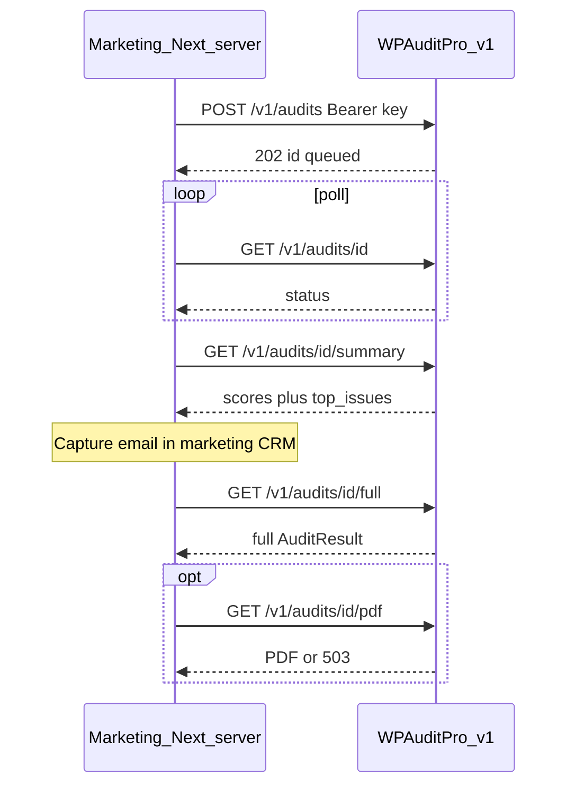

# API contract — WP Audit Pro v1 (S2S)

**Status:** Proposed contract for marketing-site server-to-server integration.  
**Not implemented** until a separate implementation approval. Today’s live routes remain `/api/audit/*` (sync).

This document describes OpenAPI-style endpoints that wrap the existing `runAudit()` engine asynchronously, with **summary** vs **full** result gating suitable for a lead magnet.

Companion docs: [INTEGRATION_NOTES.md](./INTEGRATION_NOTES.md) (as-built), [HARDENING.md](./HARDENING.md) (pre-public checklist).

---

## 1. Base URL and versioning

| Environment | Base URL (example) |
|-------------|--------------------|
| Production (Hostinger) | `https://darkviolet-opossum-510714.hostingersite.com` |
| Future custom domain | `https://<audit-api-host>` |

All v1 routes are under `/v1`. Existing `/api/audit/*` stays for the WP Audit Pro UI until a migration decision.

```
/v1/health
/v1/audits
/v1/audits/{id}
/v1/audits/{id}/summary
/v1/audits/{id}/full
/v1/audits/{id}/pdf
```

---

## 2. Authentication

```
Authorization: Bearer <AUDIT_API_KEY>
```

| Rule | Detail |
|------|--------|
| Required on | All `/v1/*` routes except optionally `GET /v1/health` (recommend: health public for probes; audits require key) |
| Scheme | `Bearer` only |
| Key storage | Server env `AUDIT_API_KEY` (or rotateable set); never `NEXT_PUBLIC_*` |
| Failure | `401` with `{ "error": { "code": "unauthorized", "message": "…" } }` |

Marketing Next.js (or CRM) holds the key server-side and never exposes it to the browser.

---

## 3. Common conventions

### Headers

| Header | Direction | Meaning |
|--------|-----------|---------|
| `Authorization` | Request | Bearer API key |
| `Content-Type` | Request | `application/json` on POST bodies |
| `X-Request-Id` | Request (optional) | Client correlation id; echoed in responses when present |
| `X-RateLimit-Limit` | Response | Window limit |
| `X-RateLimit-Remaining` | Response | Remaining in window |
| `X-RateLimit-Reset` | Response | Unix seconds when window resets |
| `Retry-After` | Response | Seconds to wait on `429` |

### Status enum

```ts
type AuditJobStatus =
  | 'queued'
  | 'running'
  | 'succeeded'
  | 'failed'
  | 'expired';
```

| Status | Meaning |
|--------|---------|
| `queued` | Accepted; not yet executing |
| `running` | `runAudit` in progress |
| `succeeded` | Result available for summary/full/pdf |
| `failed` | Terminal failure; see `error` |
| `expired` | Result purged by retention policy |

### Error envelope

```json
{
  "error": {
    "code": "invalid_url",
    "message": "Human-readable explanation",
    "details": {}
  }
}
```

| HTTP | `error.code` (examples) |
|------|-------------------------|
| 400 | `invalid_url`, `validation_error` |
| 401 | `unauthorized` |
| 403 | `forbidden`, `full_gated` |
| 404 | `not_found` |
| 409 | `conflict` (e.g. PDF while still running) |
| 429 | `rate_limited` |
| 500 | `internal_error` |
| 503 | `dependency_unavailable` (e.g. PDF/Chrome missing, DB down) |

### Job id

- Format: UUID v4 string (same family as today’s Supabase `audits.id`).

---

## 4. Endpoints

### 4.1 `GET /v1/health`

Liveness + dependency flags (mirrors today’s [`GET /api/health`](src/app/api/health/route.ts)).

**Auth:** optional / recommended public for uptime checks.

**200 Response**

```json
{
  "ok": true,
  "service": "wpaudit-pro",
  "version": "v1",
  "db": true,
  "email": true,
  "pagespeed": true,
  "pdf": false,
  "time": "2026-04-12T00:00:00.000Z"
}
```

| Field | Meaning |
|-------|---------|
| `db` | Supabase (or job store) configured |
| `email` | Resend configured |
| `pagespeed` | `GOOGLE_PAGESPEED_API_KEY` set |
| `pdf` | Chrome executable reachable for puppeteer-core |

---

### 4.2 `POST /v1/audits`

Create an async audit job.

**Auth:** required.

**Request body**

```json
{
  "url": "https://example.com",
  "email": "lead@example.com"
}
```

| Field | Type | Required | Notes |
|-------|------|----------|-------|
| `url` | string | yes | Normalized to https when missing scheme; same SSRF rules as today |
| `email` | string (email) | no | If present, may associate lead / unlock full later; validation required |

**202 Accepted**

```json
{
  "id": "550e8400-e29b-41d4-a716-446655440000",
  "status": "queued",
  "created_at": "2026-04-12T00:00:00.000Z"
}
```

**Errors:** `400` invalid URL / email; `401`; `429`.

**Implementation note (future):** enqueue work that calls existing `runAudit(url)`; do not keep the HTTP connection open for the full crawl/PSI window.

---

### 4.3 `GET /v1/audits/{id}`

Poll job status (no score payload — keep polls cheap).

**Auth:** required.

**200 Response**

```json
{
  "id": "550e8400-e29b-41d4-a716-446655440000",
  "status": "running",
  "url": "https://example.com",
  "created_at": "2026-04-12T00:00:00.000Z",
  "started_at": "2026-04-12T00:00:01.000Z",
  "finished_at": null,
  "error": null
}
```

When `status` is `failed`:

```json
{
  "id": "…",
  "status": "failed",
  "url": "https://example.com",
  "created_at": "…",
  "started_at": "…",
  "finished_at": "…",
  "error": {
    "code": "fetch_failed",
    "message": "Could not fetch the website"
  }
}
```

**404** if unknown id.

---

### 4.4 `GET /v1/audits/{id}/summary`

**Free lead-magnet slice** — scores + top issues only. Safe to show before email capture.

**Auth:** required (S2S). Marketing site may proxy this to the browser after its own session rules.

**Preconditions:** `status === 'succeeded'`; otherwise `409` with current status.

**200 Response**

```json
{
  "id": "550e8400-e29b-41d4-a716-446655440000",
  "url": "https://example.com",
  "status": "succeeded",
  "scores": {
    "overall": 72,
    "performance": 65,
    "seo": 80,
    "security": 70,
    "technical": 75,
    "accessibility": 68,
    "aeo_geo": 60
  },
  "top_issues": [
    {
      "severity": "high",
      "category": "seo",
      "title": "Missing meta description",
      "detail": "…"
    }
  ],
  "pages_crawled": 8,
  "source": "pagespeed+html+multi",
  "metrics": {
    "lcp": "2.4 s",
    "cls": "0.05"
  }
}
```

| Field | Rules |
|-------|-------|
| `top_issues` | Cap (e.g. **5–10**); prefer critical/high; **omit** full `issues_json` / `pages_json` |
| `metrics` | Optional CWV display strings when PSI ran |
| `pages_json` | **Not** included |
| `issues_json` | **Not** included |

---

### 4.5 `GET /v1/audits/{id}/full`

Gated full `AuditResult` (same shape as today’s `result` from `POST /api/audit/run`).

**Auth:** required.

**Gating (choose one policy at implementation time; document in env):**

1. Job was created with `email`, **or**
2. Extra header / query unlock token issued after lead capture, **or**
3. API key alone is enough (B2B trust model)

If gated and not unlocked → `403` `{ "error": { "code": "full_gated", … } }`.

**200 Response**

```json
{
  "id": "550e8400-e29b-41d4-a716-446655440000",
  "status": "succeeded",
  "result": {
    "url": "https://example.com",
    "overall_score": 72,
    "performance": 65,
    "seo": 80,
    "security": 70,
    "technical": 75,
    "accessibility": 68,
    "aeo_geo": 60,
    "issues_json": { },
    "pages_json": [ ],
    "pages_crawled": 8,
    "meta": { },
    "metrics": { },
    "source": "pagespeed+html+multi"
  }
}
```

`result` matches [`AuditResult`](src/lib/audit/types.ts) from [INTEGRATION_NOTES.md](./INTEGRATION_NOTES.md#3-what-each-audit-returns-auditresult).

---

### 4.6 `GET /v1/audits/{id}/pdf`

Optional PDF of the report (same generator as email attach: puppeteer-core).

**Auth:** required. Same gating as `/full` recommended.

| Outcome | HTTP | Body |
|---------|------|------|
| Success | `200` | `application/pdf` bytes; `Content-Disposition: attachment; filename="audit-{id}.pdf"` |
| Job not ready | `409` | JSON error |
| Chrome / puppeteer unavailable | `503` | `{ "error": { "code": "dependency_unavailable", "message": "PDF generation unavailable" } }` |
| Gated | `403` | `full_gated` |

On Hostinger today, PDF often fails soft without Chrome — callers must handle `503` and fall back to HTML summary/full.

---

## 5. Rate limits (contract)

Exact numbers to be finalized in HARDENING implementation; contract requires these headers on all `/v1/audits*` responses:

```
X-RateLimit-Limit: 60
X-RateLimit-Remaining: 42
X-RateLimit-Reset: 1712880000
```

Recommended dimensions (see [HARDENING.md](./HARDENING.md)):

- Per API key
- Per client IP (defense in depth)
- Daily budget per key
- Max concurrent `running` jobs per key

---

## 6. Mapping from today’s sync API

| Today | v1 equivalent | Notes |
|-------|---------------|-------|
| `POST /api/audit/run` → `{ success, result }` | `POST /v1/audits` + poll + `/summary` or `/full` | Async; no full dump on create |
| `POST /api/audit/submit` → persist + email + scores | `POST /v1/audits` with `email` + later `/full` / `/pdf`; email optional side-effect | Marketing may own email via Resend instead |
| `GET /api/audit/:auditId` | `GET /v1/audits/{id}/full` | Add auth + gating |
| `GET /api/health` | `GET /v1/health` | Add `pdf` flag |
| `GET /api/audit/history` | Out of v1 lead-magnet MVP (omit or later) | — |
| `GET /api/audit/share/:token` | Out of v1 S2S MVP | Public HTML share stays UI-oriented |

### Suggested marketing flow



---

## 7. OpenAPI skeleton (informative)

```yaml
openapi: 3.1.0
info:
  title: WP Audit Pro S2S API
  version: 1.0.0
servers:
  - url: https://darkviolet-opossum-510714.hostingersite.com
security:
  - bearerAuth: []
paths:
  /v1/health:
    get:
      security: []
      summary: Liveness and dependency flags
  /v1/audits:
    post:
      summary: Create async audit job
      requestBody:
        required: true
        content:
          application/json:
            schema:
              type: object
              required: [url]
              properties:
                url: { type: string, format: uri }
                email: { type: string, format: email }
      responses:
        '202':
          description: Queued
  /v1/audits/{id}:
    get:
      summary: Poll job status
  /v1/audits/{id}/summary:
    get:
      summary: Lead-magnet scores and top issues
  /v1/audits/{id}/full:
    get:
      summary: Full AuditResult (gated)
  /v1/audits/{id}/pdf:
    get:
      summary: PDF report or 503 if Chrome missing
components:
  securitySchemes:
    bearerAuth:
      type: http
      scheme: bearer
```

---

## 8. Non-goals for v1

- Browser-direct calls with the API key
- Replacing the WP Audit Pro marketing UI
- Guaranteeing PDF on Hostinger without Chrome installed
- Changing cheerio / PSI scoring algorithms (engine stays as-is; only delivery shape changes)

**Implementation requires a separate go-ahead.** Until then, use [INTEGRATION_NOTES.md](./INTEGRATION_NOTES.md) against `/api/audit/*` only in private / trusted contexts.
