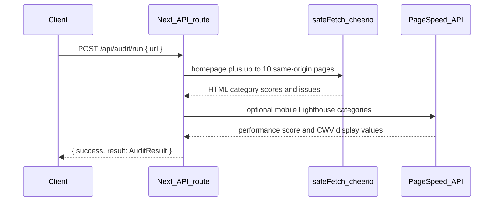

# Integration notes — WP Audit Pro

As-built reference for integrating this app as a **server-to-server** lead-magnet backend for a separate marketing Next.js site.

**Scope of this document:** facts about the current codebase and Hostinger deploy.  
**Not in this document:** UI changes or new features. See [API_CONTRACT.md](./API_CONTRACT.md) for the proposed v1 S2S API (not implemented yet) and [HARDENING.md](./HARDENING.md) before public exposure.

---

## 1. Stack and framework

| Layer | Technology |
|-------|------------|
| Framework | **Next.js 15.5** (App Router) |
| UI | React **19**, TypeScript, Tailwind CSS **4** |
| Runtime | Node.js route handlers (`export const runtime = 'nodejs'`) |
| HTML analysis | **cheerio** |
| Performance / CWV | **Google PageSpeed Insights API v5** (optional; Lighthouse categories via PSI — **not** a local Lighthouse CLI run) |
| PDF generation | **puppeteer-core** + system Chrome (optional; used only for PDF, **not** for crawling) |
| Persistence | **Supabase** (Postgres) via service role key |
| Email | **Resend** |
| Package manager | npm (`package-lock.json`) |

Key paths:

- Engine: [`src/lib/audit/engine.ts`](src/lib/audit/engine.ts)
- Types: [`src/lib/audit/types.ts`](src/lib/audit/types.ts)
- Crawler: [`src/lib/audit/crawler.ts`](src/lib/audit/crawler.ts)
- SSRF / fetch: [`src/lib/urls.ts`](src/lib/urls.ts)
- HTTP APIs: [`src/app/api/`](src/app/api/)

---

## 2. How audits run

### Pipeline (synchronous today)



Steps inside `runAudit()`:

1. **SSRF gate** — `assertPublicUrl` / `normalizeUrl` ([`src/lib/urls.ts`](src/lib/urls.ts)).
2. **Fetch homepage** — `safeFetch` with UA `WPAuditPro/1.0 (+https://wpaudit.pro)`.
3. **Discover pages** — sitemap (`/sitemap.xml`, `/sitemap_index.xml`, `/wp-sitemap.xml`) then same-origin `<a href>` links; **max 10** pages ([`crawler.ts`](src/lib/audit/crawler.ts)).
4. **Per-page HTML scoring** — cheerio: SEO, security headers, accessibility, technical, AEO/GEO heuristics; merge issues.
5. **Origin extras** — robots.txt / llms.txt (AEO), sitemap presence (SEO).
6. **Optional PageSpeed** — if `GOOGLE_PAGESPEED_API_KEY` is set, call PSI mobile with categories `performance`, `seo`, `accessibility`, `best-practices` (timeout 45s). Blends PSI scores into performance / seo / accessibility / security; attaches CWV display strings (`fcp`, `lcp`, `tti`, `tbt`, `cls`).
7. **Overall score** — weighted blend of the six categories.

### What is *not* used

- Local Lighthouse CLI / Chrome DevTools Protocol for crawl.
- Playwright / Puppeteer for page rendering or audits.
- Headless Chrome for fetching HTML (Chrome is **PDF-only** via [`src/lib/pdf.ts`](src/lib/pdf.ts)).

Without PSI, performance falls back to a simple HTML byte-size heuristic and an issue notes that PageSpeed is not configured.

### Related user flows

| Endpoint | Behavior |
|----------|----------|
| `POST /api/audit/run` | Run audit; return full `AuditResult` in one response (no DB required). |
| `POST /api/audit/submit` | Run audit → persist to Supabase → optional PDF → email via Resend → return ids/scores. |
| `GET /api/audit/:auditId` | Load persisted audit JSON (no `share_token` in projection). |
| `GET /api/audit/history?email=&url=` | Prior overall scores for that email + hostname (knowledge-gated). |
| `GET /api/audit/share/:shareToken` | HTML report template. |
| `GET /api/health` | `{ ok, service, db, email, pagespeed, time }`. |

---

## 3. What each audit returns (`AuditResult`)

Defined in [`src/lib/audit/types.ts`](src/lib/audit/types.ts).

```ts
type Severity = 'critical' | 'high' | 'medium' | 'low';

type Issue = {
  severity: Severity;
  title: string;
  detail: string;
  impact?: 'high' | 'medium' | 'low';
  effort?: 'easy' | 'medium' | 'hard';
};

type IssueBucket = {
  performance: Issue[];
  seo: Issue[];
  security: Issue[];
  technical: Issue[];
  accessibility: Issue[];
  aeo_geo: Issue[];
};

type PageSummary = {
  url: string;
  title: string;
  overall_score: number;
  seo: number;
  accessibility: number;
  isWordPress: boolean;
};

type AuditResult = {
  url: string;
  overall_score: number;      // 0–100
  performance: number;
  seo: number;
  security: number;
  technical: number;
  accessibility: number;
  aeo_geo: number;
  issues_json: IssueBucket;
  pages_json: PageSummary[];
  pages_crawled: number;
  meta: {
    title: string;
    metaDesc: string;
    h1Count: number;
    isHttps: boolean;
    hasWp: boolean;
    canonical?: string;
    technologies?: string[];
    hostingHint?: string;
  };
  metrics?: {
    fcp?: string;
    lcp?: string;
    tti?: string;
    tbt?: string;
    cls?: string;
  };
  source: string; // e.g. "pagespeed+html+multi" | "html-multi"
};
```

### Response envelopes (current)

**Run**

```json
{ "success": true, "result": { /* AuditResult */ } }
```

**Submit** (after persist)

```json
{
  "success": true,
  "auditId": "<uuid>",
  "shareLink": "https://…/share/<token>",
  "shareToken": "<24-hex>",
  "scores": {
    "overall": 0,
    "performance": 0,
    "seo": 0,
    "security": 0,
    "technical": 0,
    "accessibility": 0,
    "aeo_geo": 0
  }
}
```

Errors: `{ "success": false, "error": "<message>" }` with HTTP 400 / 429 / 500 / 503 as appropriate.

---

## 4. Typical duration

| Phase | Cap / expectation |
|-------|-------------------|
| Product messaging | Typically under ~60 seconds |
| HTML fetch per URL | **15s** timeout |
| Soft fetches (robots/llms/sitemap) | **8s**, ≤64KB |
| PageSpeed Insights | **45s** timeout |
| Route budget | `maxDuration = 120` (Vercel-style hint; Hostinger may enforce differently) |
| Pages crawled | **1–10** |
| Redirects | **≤5** |
| Response body | **≤2MB** (sitemaps ≤512KB) |

Worst case approaches the 2-minute route budget when PSI is slow and many pages are crawled.

---

## 5. Per-run cost, quotas, and keys

| Dependency | Env key(s) | Per-run cost signal |
|------------|------------|---------------------|
| Hostinger Node hosting | — | Plan cost (fixed); live host below |
| Google PageSpeed Insights | `GOOGLE_PAGESPEED_API_KEY` | Subject to **Google PSI API quotas / rate limits** for that key; free tier exists but is not unlimited. Omit key → no PSI charge, weaker performance score. |
| Supabase | `SUPABASE_URL`, `SUPABASE_SERVICE_KEY` | DB write on submit/history/share; plan quotas |
| Resend | `RESEND_API_KEY`, `RESEND_FROM_EMAIL` | **One email** per successful submit (PDF attached when Chrome works) |
| Chrome / Puppeteer | `PUPPETEER_EXECUTABLE_PATH` | Often **unavailable on Hostinger** → PDF skipped; email may still send without attachment |

There is **no** separate paid Lighthouse SaaS in-app. Marginal cost of a “run-only” audit (no email) is mainly Hostinger CPU + optional PSI.

`DASHBOARD_API_KEY` is reserved in `.env.example` but **unused** by routes today.

---

## 6. Deployment

| Item | Value |
|------|--------|
| Host | **Hostinger** Node.js Web App (`app_type: next`) |
| Live preview | `https://darkviolet-opossum-510714.hostingersite.com` |
| Git | `chriscodes-io/wpaudit-pro` branch `main` |
| Account username | `u331323563` (see [`.hostinger/site.json`](.hostinger/site.json)) |
| Build | `npm run build` on Hostinger |
| Start | `next start` via `npm start` (honors `PORT`) |

### Environment variables

From [`.env.example`](.env.example):

| Key | Required for |
|-----|----------------|
| `SITE_URL` | Canonicals, share links, sitemap |
| `NEXT_PUBLIC_SITE_URL` | Client-visible site URL (baked at build) |
| `SUPABASE_URL` / `SUPABASE_SERVICE_KEY` | submit, history, share, audit-by-id |
| `RESEND_API_KEY` / `RESEND_FROM_EMAIL` | PDF email on submit |
| `GOOGLE_PAGESPEED_API_KEY` | Lighthouse-via-PSI scores |
| `PUPPETEER_EXECUTABLE_PATH` | PDF generation |
| `DASHBOARD_API_KEY` | Unused |

Schema: [`supabase/migrations/001_initial.sql`](supabase/migrations/001_initial.sql).

---

## 7. Existing auth and rate limiting

### Auth

- **No API keys, sessions, or OAuth** on audit APIs.
- Supabase **service role** is server-only (never `NEXT_PUBLIC_`).
- Share reports use an opaque **share_token** (24 hex chars from `randomBytes(12)`).
- History is **knowledge-gated** (caller must supply matching `email` + `url`); not proof of ownership.

### Rate limits

In-memory sliding window ([`src/lib/rateLimit.ts`](src/lib/rateLimit.ts)) — **single process only**:

| Route | Limit |
|-------|--------|
| `POST /api/audit/run` | **8 / IP / minute** |
| `POST /api/audit/submit` | **5 / IP / minute** |
| `GET /api/audit/history` | **20 / IP / minute** |

Client IP: right-most `X-Forwarded-For` hop (assumes trusted edge), else `X-Real-Ip`.

No per-day caps, no concurrency semaphore, no shared store across instances.

### CORS

[`next.config.ts`](next.config.ts) sets `Access-Control-Allow-Origin: *` on `/api/audit/submit` (marketing CTA). Submit also handles `OPTIONS`.

---

## 8. Security gaps (especially SSRF)

### Protections already in place ([`src/lib/urls.ts`](src/lib/urls.ts))

- Protocols: **http / https only**; URL userinfo rejected.
- Host blocks: `localhost`, `*.localhost`, `*.local`, `metadata.google.internal`, `metadata.google.com`.
- After DNS lookup: reject if **any** address is private (RFC1918, loopback, link-local, ULA IPv6, CGNAT `100.64/10`, `169.254/16` incl. cloud metadata).
- IPv4-mapped IPv6 (`::ffff:…`) expanded before classification; hostname brackets stripped.
- Redirects: manual follow, **re-assert** each hop, max **5**.
- Body size and timeouts as above.
- Crawler stays **same-origin** for discovered pages.

### Gaps relevant to public / S2S use

1. **DNS rebinding TOCTOU** — DNS is checked, then `fetch(hostname)` lets the runtime resolve again; a short-TTL record can flip to a private IP between check and connect. **No connect-to-resolved-IP pinning.**
2. **No API-key auth** — anyone who can reach the host can burn crawl / PSI / (on submit) email quota.
3. **CORS `*`** on submit — any browser origin can call it.
4. **In-memory rate limits** — reset on restart; ineffective across multiple Node processes; spoofable if requests bypass a trusted proxy.
5. **No concurrency / daily budgets** for PSI or Resend.
6. **`GET /api/audit/:auditId`** — unauthenticated UUID capability URL returning full issue/page payloads (no `share_token`, but still sensitive operational data).
7. **Logging** — submit path `console.error`s full errors; risk of logging URLs / stack context.
8. **Health endpoint** publicly discloses whether DB / email / PageSpeed are configured.

**Bottom line:** A user **cannot trivially** pass `http://127.0.0.1` or `http://169.254.169.254` as the URL today (blocked by checks), but a sophisticated **DNS-rebinding** target remains a residual SSRF risk until connect pinning (or equivalent) is implemented. See [HARDENING.md](./HARDENING.md).

---

## 9. Mapping to marketing lead magnet

| Marketing need | Current app | Gap for clean S2S |
|----------------|-------------|-------------------|
| Trigger audit from website backend | `POST /api/audit/run` (sync) | Prefer async job API ([API_CONTRACT.md](./API_CONTRACT.md)) |
| Show free teaser scores | Full `result` returned at once | Need explicit **summary** vs **full** split |
| Gate full report behind email / CRM | `submit` ties email + PDF | Need gated `/full` + lead token / API key |
| PDF | Via email on submit; no dedicated PDF HTTP endpoint for S2S | Proposed `GET …/pdf` |
| Auth between sites | None | API key + locked CORS |

No application code has been changed for this documentation pass.
